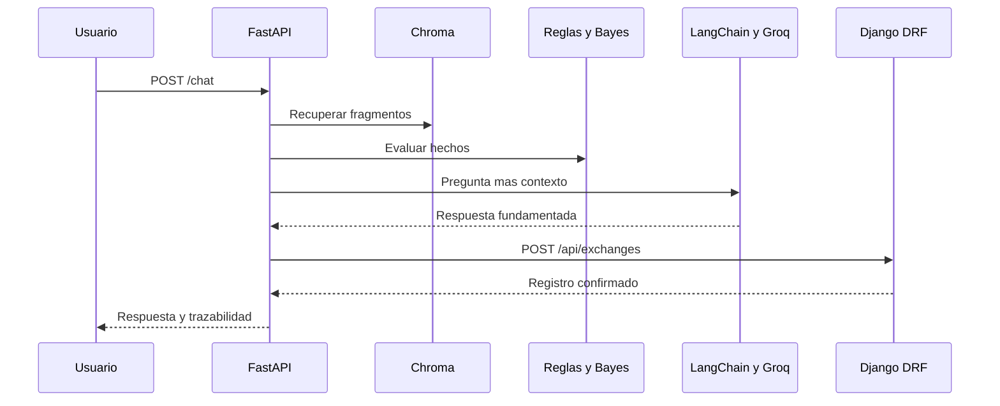

# Arquitectura del Entregable 2

## Componentes

1. Cliente web: envia preguntas y muestra respuesta, fuentes, reglas y probabilidad.
2. FastAPI: valida solicitudes y coordina el agente.
3. LangChain y Groq: generan la respuesta en lenguaje natural.
4. Chroma: conserva los vectores de los fragmentos documentales.
5. Motor de reglas: extrae hechos y ejecuta reglas deterministas.
6. Modulo Bayes: actualiza una probabilidad previa con evidencias disponibles.
7. Django y DRF: administran conversaciones, mensajes, reglas, documentos y auditoria.
8. SQLite: persistencia academica del microservicio de gestion.

## Flujo de una consulta

## Decisiones

- Chroma se ejecuta localmente para evitar servicios pagados y simplificar la demostracion.
- Los embeddings por hashing permiten una instalacion reproducible sin descargar un segundo modelo.
- Django y FastAPI son microservicios separados y se comunican mediante HTTP JSON.
- FastAPI sigue disponible cuando Django esta apagado; solo se omite la persistencia.
- Las reglas de seguridad tienen prioridad y son visibles mediante sus codigos.
- Bayes se presenta como estimacion demostrativa y no como prediccion agronomica validada.

## Contrato principal

FastAPI recibe `message` y `session_id`. Django recibe la interaccion completa, las fuentes recuperadas, las reglas activadas y la probabilidad calculada. El contrato detallado y ejemplos se encuentran en el README.
