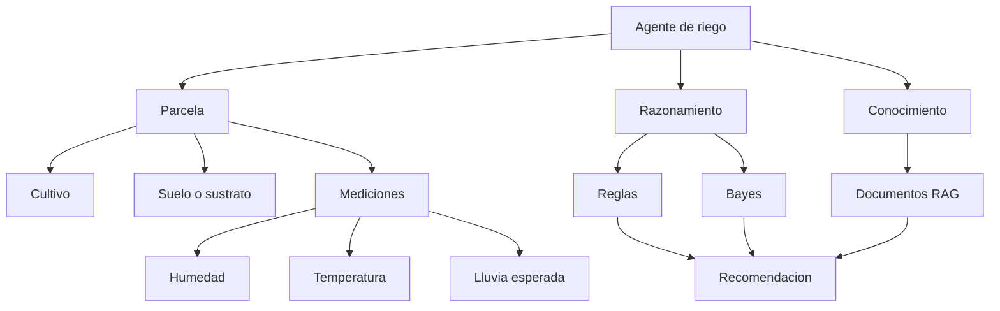

# Modelo del conocimiento del agente de riego

## Mapa conceptual

## Red semantica

- El agente **consulta** documentos de conocimiento.
- Un documento **describe** un cultivo, suelo, sensor o procedimiento.
- Una parcela **contiene** un cultivo.
- Un cultivo **crece en** suelo o sustrato.
- Un sensor **produce** una medicion.
- Una medicion **describe** el estado de la parcela.
- Una regla **evalua** hechos extraidos de la consulta.
- El modulo Bayes **combina** evidencias y produce una probabilidad.
- El agente **integra** conocimiento, reglas y probabilidad.
- Una recomendacion **incluye** fuentes, reglas activadas y limitaciones.

## Jerarquia de entidades

1. Sistema
   - Agente FastAPI
   - Servicio de gestion Django
   - Base vectorial Chroma
2. Dominio agricola
   - Parcela
   - Cultivo
   - Suelo o sustrato
   - Sistema de riego
3. Observaciones
   - Humedad
   - Temperatura
   - Lluvia esperada
4. Razonamiento
   - Hechos
   - Reglas
   - Evidencias bayesianas
   - Recomendacion

## Base documental indexada

La carpeta `knowledge` contiene principios de riego, suelos, cultivos, sensores, seguridad, preguntas frecuentes y politica de respuesta. El comando `python -m app.ingest` divide los documentos, genera embeddings locales reproducibles y almacena los vectores en Chroma.
